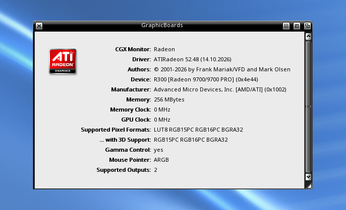
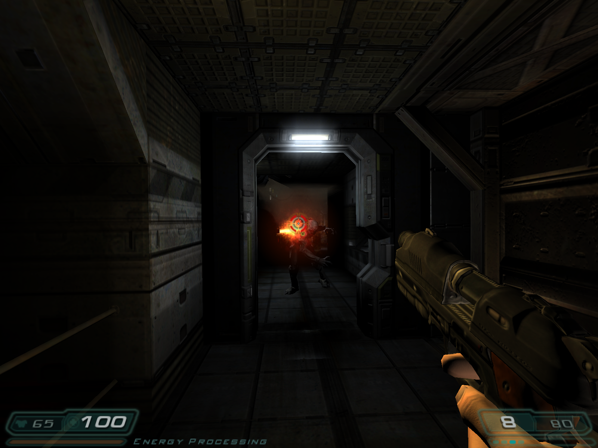

# MorphOS on QEMU with a Radeon 9700

Run MorphOS on a Linux PC or an Apple Silicon Mac with an emulated PowerPC G4, 2 GB of RAM and a Radeon 9700 with 256 MB of VRAM. MorphOS uses its own Radeon driver, and the host GPU renders 3D through Vulkan.

QEMU’s contributors built the PowerPC emulator and the `mac99` machine that MorphOS boots on. linuxkid473 extended PowerEmu’s Radeon 9200 emulation to the Radeon 9700 and implemented the Vulkan renderer. I built on their work to get MorphOS’s own Radeon driver running, then tracked down the details that mattered in daily use, from framebuffer colours to the hardware cursor. [QEMU](https://www.qemu.org/) · [linuxkid473’s Radeon fork](https://github.com/linuxkid473/poweremu-qemu)

This is a personal hobby project. I have no affiliation with the MorphOS Team. If you’ve never tried MorphOS, I encourage you to boot the Live CD in QEMU and spend a little time exploring Ambient. QEMU gives you a feel for the desktop, but it will never fully reproduce the responsiveness of a real PowerPC machine or the way its hardware behaves. If you enjoy MorphOS, I hope you’ll try it on supported hardware and buy a license from the team. [Supported hardware](https://www.morphos-team.net/hardware) · [How to register MorphOS](https://www.morphos-team.net/faq)

**[Download for Linux x86_64 (ZIP)][linux-zip]** · **[Download for Apple Silicon (ZIP)][mac-zip]** · [Build from source](docs/MORPHOS-QUICKSTART.md) · [QEMU fork](https://github.com/wiktorglowacki/poweremu-qemu)

Nightly builds · [Linux x86_64](https://nightly.link/wiktorglowacki/ppc-osx-vgpu/workflows/qemu-linux/release%2Fmorphos-radeon/ppcosx-qemu-linux-x86_64.zip) · [Apple Silicon](https://nightly.link/wiktorglowacki/ppc-osx-vgpu/workflows/qemu-macos/release%2Fmorphos-radeon/ppcosx-qemu-macos-arm64.zip)

[linux-zip]: https://github.com/wiktorglowacki/ppc-osx-vgpu/releases/latest/download/ppcosx-qemu-linux-x86_64.zip
[mac-zip]: https://github.com/wiktorglowacki/ppc-osx-vgpu/releases/latest/download/ppcosx-qemu-macos-arm64.zip

[](docs/images/morphos-graphicboards-desktop.png)

MorphOS identifies the card as **R300 [Radeon 9700/9700 PRO]** (PCI ID `1002:4e44`) with 256 MB of VRAM, driven by ATIRadeon 52.48. Select the screenshot to see the full Ambient desktop.



Doom 3 running fullscreen at 1600×1200 on MorphOS, captured in-game with the packaged emulator and an RTX 5090 Vulkan host.

## Boot the MorphOS Live CD

Use an **x86_64 Linux** desktop with SDL/OpenGL and a working Vulkan driver. The screenshots above were captured on Fedora 44. The prebuilt archive uses Ubuntu 24.04 libraries, so on Fedora you may need additional runtime libraries or a native build. [Linux runtime dependencies](docs/LINUX-ARCHIVE.md) · [Build from source](docs/MORPHOS-QUICKSTART.md)

1. Download the [Linux x86_64 ZIP][linux-zip]. It contains QEMU and the Radeon launcher.
2. Download the **Live CD Image** from the [MorphOS team](https://www.morphos-team.net/downloads).
3. Get the checked 2018 `openbios-qemu.elf` and the patched Radeon display driver, `qemu_vga_hwc.ndrv`. The [OpenBIOS instructions](firmware/PROVENANCE.md#morphos-2018-openbios) verify and extract the firmware. The [NDRV file](firmware/radeon/qemu_vga_hwc.ndrv) is in this repository.

From your download directory, unpack the emulator and check that it can load the Radeon device and SDL frontend.

```sh
unzip ppcosx-qemu-linux-x86_64.zip
tar -xJf ppcosx-qemu-linux-x86_64.tar.xz
cd ppcosx-qemu
sha256sum -c SHA256SUMS
./tools/morphos-run.sh --check
```

Replace the three example paths with your own files to boot the Live CD.

```sh
MORPHOS_ISO=/path/to/morphos.iso \
MORPHOS_FIRMWARE=/path/to/openbios-qemu.elf \
MORPHOS_NDRV=/path/to/qemu_vga_hwc.ndrv \
./tools/morphos-run.sh
```

You can boot the Live CD without a hard disk. To boot an existing installation, add `MORPHOS_HD=/path/to/system.img` and `MORPHOS_BOOT=hd` to the same command. Use a copy of your image for a first test.

## Apple Silicon

Download the [native arm64 ZIP][mac-zip] for macOS 15 or later. Unpack it and install the listed runtime libraries with Homebrew.

```sh
unzip ppcosx-qemu-macos-arm64.zip
tar -xzf ppcosx-qemu-macos-arm64.tar.gz
cd ppcosx-qemu
shasum -a 256 -c SHA256SUMS
xargs brew install < runtime-formulae.txt
./tools/morphos-run.sh --check
```

Follow the [Mac launch instructions](docs/MACOS-ARCHIVE.md) for the Live CD, OpenBIOS and Radeon display driver.

### Build from source on Apple Silicon

Install Homebrew and the Xcode Command Line Tools, then build QEMU in a native Mac terminal (`uname -m` should print `arm64`).

```sh
git clone --branch release/morphos-radeon --recurse-submodules https://github.com/wiktorglowacki/ppc-osx-vgpu.git
cd ppc-osx-vgpu
./ppcosx setup --build
```

Download the [MorphOS Live CD](https://www.morphos-team.net/downloads) and follow the [OpenBIOS instructions](firmware/PROVENANCE.md#morphos-2018-openbios). Set the ISO path below to your download. The launcher opens a Cocoa window and uses Vulkan through MoltenVK.

```sh
MORPHOS_ISO="$HOME/Downloads/morphos.iso" \
MORPHOS_FIRMWARE="$HOME/.local/share/morphos-qemu/openbios-qemu.elf" \
./tools/morphos-run.sh
```

## Source and credits

This repository contains the launcher. The [QEMU submodule](qemu) pins the exact emulator revision used for the binary. In both repositories, `release/morphos-radeon` carries the MorphOS changes and `upstream-clean` marks the cleaned upstream baseline.

The launcher is adapted from [linuxkid473’s original bundle](https://github.com/linuxkid473/ppc-osx-vgpu). Thanks also to [Spartan0285 and the PowerEmu contributors](https://github.com/Spartan0285/poweremu-qemu) for the earlier Radeon emulation and to the [PowerEmu project](https://github.com/Spartan0285/PowerEmu) for the hardware cursor driver.

[Bundle license](LICENSE) · [Firmware and display driver credits](firmware/PROVENANCE.md)
